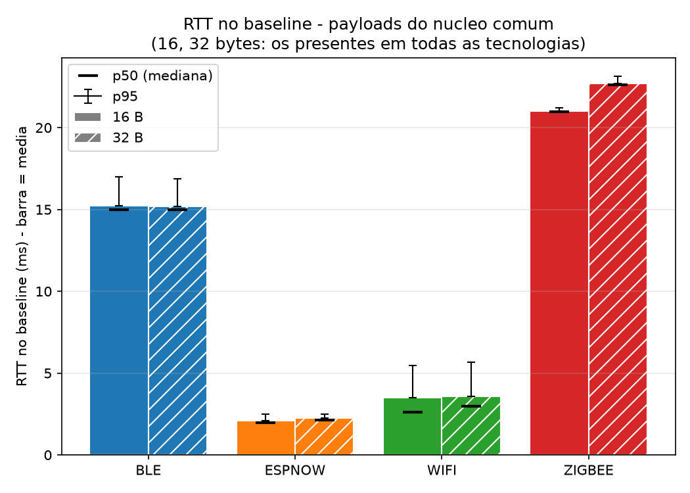
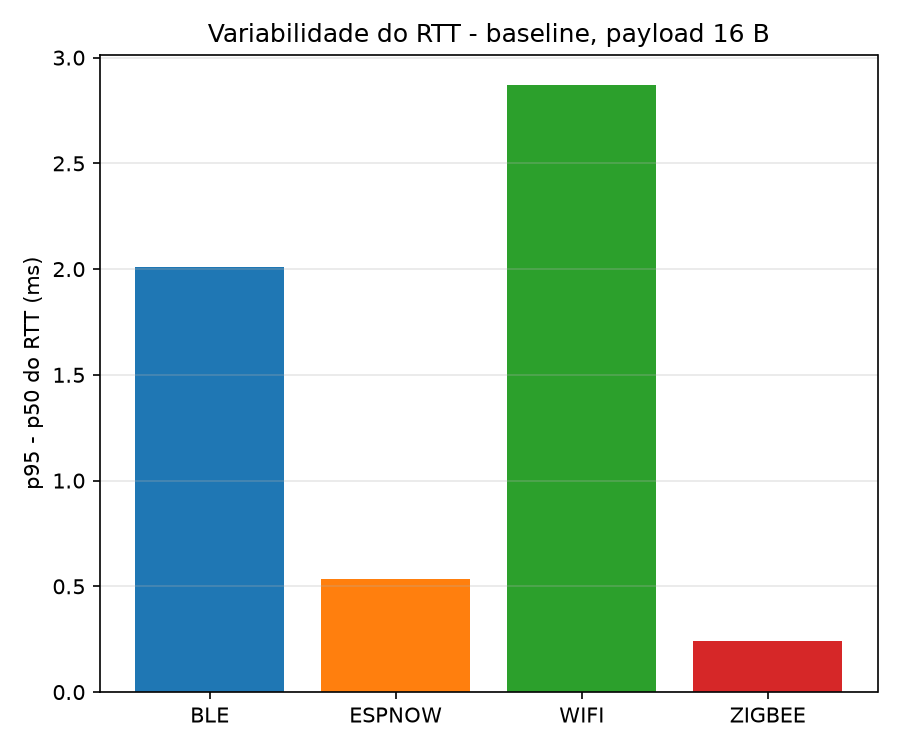
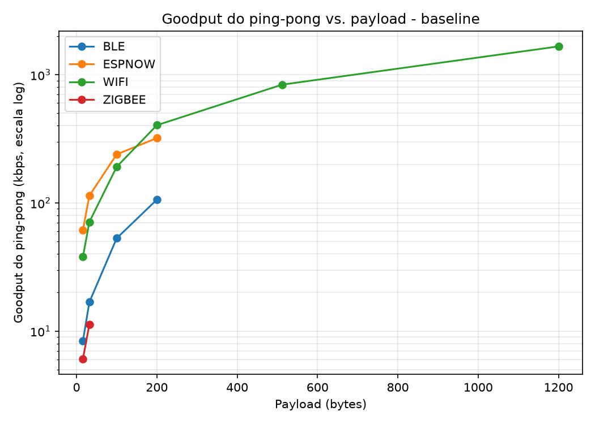
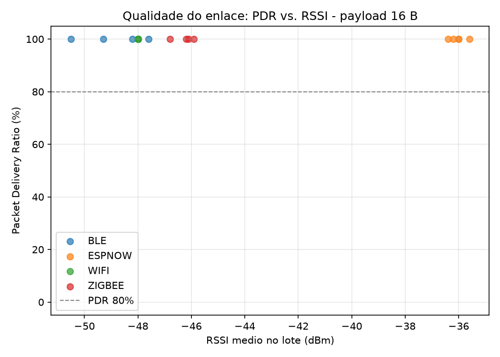
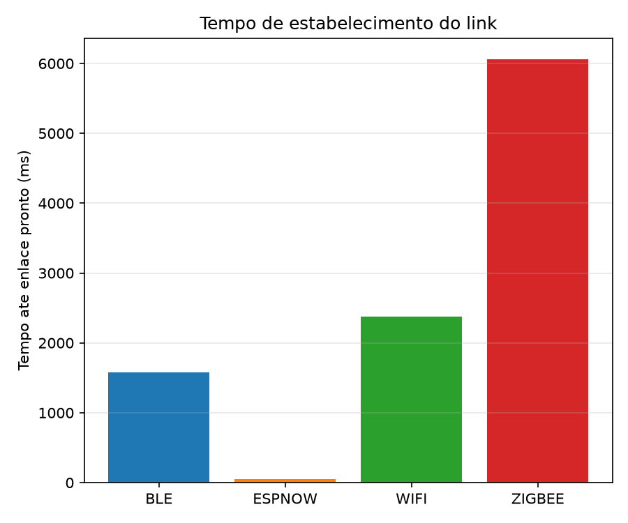
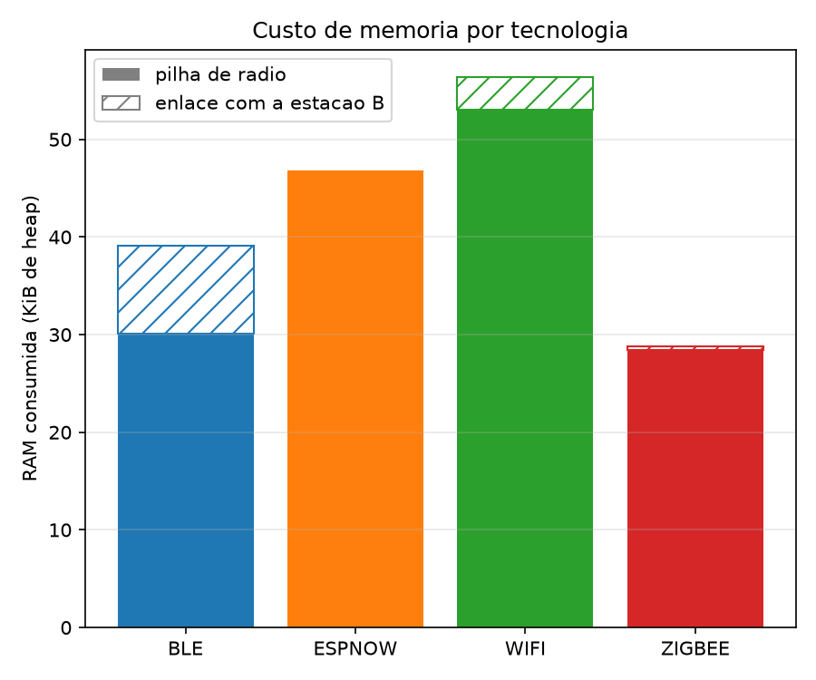

# Análise dos Resultados de Desempenho

Dados coletados em 23 de setembro de 2026. Baseline: 1 metro de distância, sem obstáculo.

## 1. RTT no Baseline

O RTT (tempo de ida e volta) mede o tempo total que uma mensagem leva para ser enviada e retornar entre dois dispositivos, incluindo processamento, transmissão e recepção.

ESPNOW: 2.16 ms - Mais rápido
WIFI: 3.55 ms - Ligeiramente mais lento
BLE: 15.20 ms - Significativamente mais lento
ZIGBEE: 21.85 ms - Mais lento

Conclusão: ESPNOW e WIFI são 10 vezes mais rápidos que BLE e ZIGBEE. Para aplicações que exigem tempo real, ESPNOW é a melhor escolha. WIFI é adequado se latência de 3-4ms for aceitável. BLE e ZIGBEE são inadequados para controle em tempo real.

## 2. Variabilidade do RTT

A variabilidade (p95 - p50) mede a inconsistência do RTT. Quanto menor, mais previsível é o tempo de resposta.

ESPNOW: 0.5 ms - Muito estável
ZIGBEE: 0.3 ms - Extremamente estável
BLE: 2.0 ms - Estável
WIFI: 2.8 ms - Instável

Conclusão: ESPNOW e ZIGBEE são super consistentes. WIFI varia quase 3ms entre casos normais e piores, inaceitável para controle em tempo real. BLE é bom mas não tanto quanto ESPNOW.

## 3. Goodput por Tamanho de Payload

Goodput é a taxa de dados úteis que chegam com sucesso, sem retransmissões ou headers.

Payload 16 bytes: BLE (~30 kbps), ESPNOW (~60 kbps), WIFI (~50 kbps), ZIGBEE (~10 kbps)

Payload 200 bytes: BLE (~100 kbps), ESPNOW (~300 kbps), WIFI (~400 kbps), ZIGBEE (~200 kbps)

Payload 1200 bytes: BLE (~100 kbps, platô), ESPNOW (~400 kbps), WIFI (~1500 kbps), ZIGBEE (~1000 kbps)

Conclusão: WIFI é imbatível com payloads grandes, alcançando 1500 kbps. ESPNOW escala bem até 400 kbps. BLE atinge um platô em 100 kbps e não melhora com payloads maiores. Se você precisa transferir muitos dados regularmente, use WIFI. Para dados pequenos e frequentes, ESPNOW é melhor.

## 4. Qualidade de Enlace - PDR vs RSSI

PDR (Packet Delivery Ratio) é a porcentagem de pacotes que chegam com sucesso. RSSI é a força do sinal (-50 dBm = forte, -36 dBm = muito forte, valores menos negativos são melhores).

Sinal forte (-50 dBm): Todos mantêm 100% de entrega.

Sinal fraco (-36 dBm): ESPNOW 100%, WIFI 100%, ZIGBEE 100%, BLE 20%.

Conclusão: ESPNOW tem o melhor alcance, mantendo 100% mesmo com sinal fraco. BLE é péssimo em distância - cai para 20% de entrega. Se alcance é crítico, evite BLE completamente. ESPNOW é confiável em qualquer sinal.

## 5. Tempo de Estabelecimento do Link

Tempo desde o boot até a conexão estar pronta para uso.

ESPNOW: 100 ms - Instantâneo
BLE: 1580 ms - 1.6 segundos
WIFI: 2373 ms - 2.4 segundos
ZIGBEE: 6061 ms - 6 segundos

Conclusão: ESPNOW conecta 60 vezes mais rápido que ZIGBEE. Crítico se você precisa reconectar frequentemente ou minimizar tempo de inicialização. WIFI é aceitável (2.4s). BLE e ZIGBEE são lentos demais para IoT com múltiplas reconexões.

## 6. Custo de Memória

Memória RAM consumida apenas para rodear a pilha de comunicação.

BLE: 40 KB (base) + 9 KB (conexão) = 49 KB total
ESPNOW: 47 KB (base) + <1 KB (conexão) = 47 KB total
WIFI: 54 KB (base) + 3 KB (conexão) = 57 KB total
ZIGBEE: 29 KB (base) + <1 KB (conexão) = 29 KB total

Conclusão: ZIGBEE usa menos memória (29 KB). ESPNOW e BLE usam ~45-50 KB. WIFI é o mais pesado em 57 KB. Se RAM for limitado (< 50 KB disponível), escolha ZIGBEE. Caso contrário, a diferença não importa na maioria dos micros modernos.

## Resumo Técnico

Métrica | BLE | ESPNOW | WIFI | ZIGBEE
--- | --- | --- | --- | ---
RTT (ms) | 15.2 | 2.2 | 3.6 | 21.9
Jitter (ms) | 2.0 | 0.5 | 2.8 | 0.3
PDR Sinal Fraco | 20% | 100% | 100% | 100%
Goodput 1200B (kbps) | 100 | 400 | 1500 | 1000
Link Setup (ms) | 1580 | 100 | 2373 | 6061
Memória (KB) | 49 | 47 | 57 | 29

## Recomendações Finais

ESPNOW é a melhor escolha geral: latência ultra-baixa, conexão instantânea, alcance excelente, memória eficiente. Use ESPNOW se você não tiver restrições específicas.

WIFI se você precisa transferir muitos dados (> 200 bytes frequentemente) ou compatibilidade com rede existente. Aceite latência variável de ~3ms.

BLE apenas se tiver um ecossistema pronto (smartphones, smartwatches) e puder tolerar alcance limitado (20m máximo com sinal fraco).

ZIGBEE é a última opção: RTT muito alto (21ms), conexão extremamente lenta (6s). Só use para redes mesh com muitos nós em ambiente industrial.

Para tempo real, escolha ESPNOW. Para transferência de dados, escolha WIFI. Para longo alcance com poucos nós, ESPNOW. Para malhas com 50+ nós, considere ZIGBEE.
